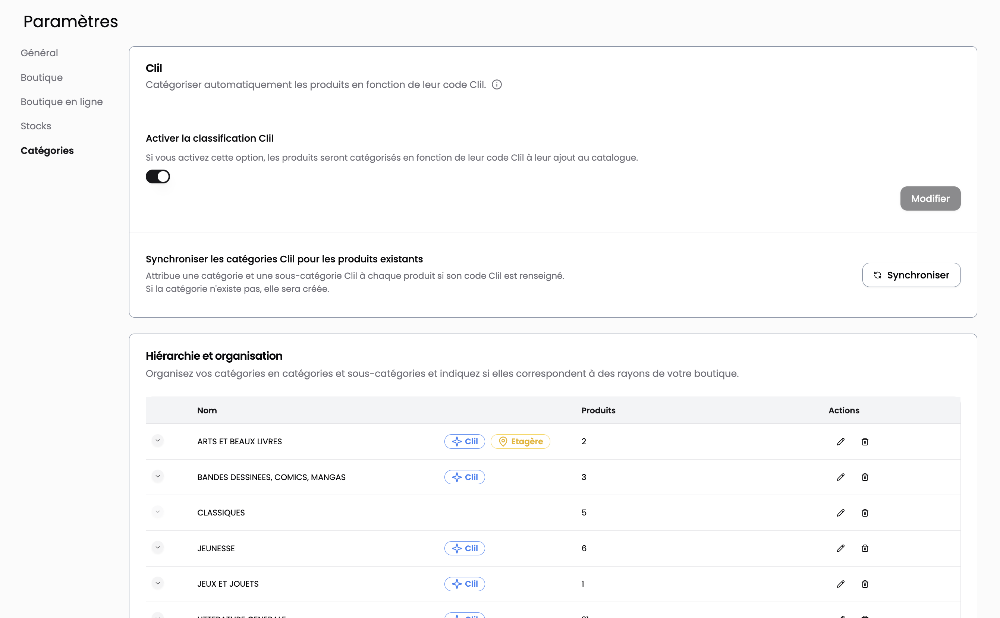

## Pourquoi catégoriser vos livres dans Alexandrie ?

Classer vos livres en catégories revient à les regrouper selon un ou plusieurs critères communs. Ces critères peuvent être **thématiques** (ex : Histoire, Jeunesse, Polar), **typologiques** (ex : Livre, Revue, Carte, Produit dérivé) ou **organisationnels** (ex : Rayon en boutique).

Une bonne catégorisation facilite à la fois le **travail en rayon**, la **navigation sur votre site** et la **gestion de votre stock**.

En magasin, elle simplifie la mise en place et le réassort.

En ligne, elle guide vos clients — qui n’ont pas le soutien d’un·e libraire — à travers un chemin clair et efficace.

Enfin, côté back-office, elle vous donne une vision structurée de votre assortiment, vous aide à identifier des produits similaires, et enrichit les statistiques d’Alexandrie (performances par genre ou thématique, etc.).

## Comment fonctionne le système de catégories ?

Le système est conçu pour être **flexible** et **puissant**. Vous pouvez :

- Créer autant de catégories que nécessaire
- Associer plusieurs catégories à un même produit (ex : un titre peut être à la fois “Écologie”, “Essai” et “Jeunesse”)

Deux niveaux sont proposés : **catégorie** et **sous-catégorie**.

Cette hiérarchie est avant tout **visuelle** : chaque niveau reste indépendant, mais elle permet une navigation plus intuitive.

> ⚠️ Certaines catégories affichent une **icône spécifique**, dans deux cas :
>
> Lorsqu’elles correspondent à un **emplacement physique** dans votre librairie (ex : *Rayon BD adulte*)
>
> Lorsqu’elles ont été **créées automatiquement** à partir d’un **thème CLIL**, la classification professionnelle du monde du livre

## Quelle différence avec les collections Shopify ?

Dans Shopify, une *collection* est un groupe de produits que vous pouvez afficher sur votre site ou utiliser pour appliquer des règles (remises, mises en avant, etc.).

Ces collections peuvent être remplies **manuellement** ou **automatiquement**, en fonction de critères comme des balises ou des champs méta.

👉 Lorsqu’une catégorie est créée dans Alexandrie, une **collection miroir** est automatiquement générée dans Shopify, liée via le métafield “catégorie”.

Cela vous permet de **ne gérer qu’un seul système de classement** tout en synchronisant votre site sans effort supplémentaire.

## Pourquoi utiliser les catégories Alexandrie ?

Utiliser le système de catégories d’Alexandrie présente plusieurs avantages :

- **Gain de temps** : la catégorisation se fait dès la création ou la réception du produit
- **Statistiques détaillées** : vos rapports intègrent une analyse par genre ou thématique
- **Automatisation** : vous pouvez attribuer des catégories automatiquement selon le thème CLIL du produit
