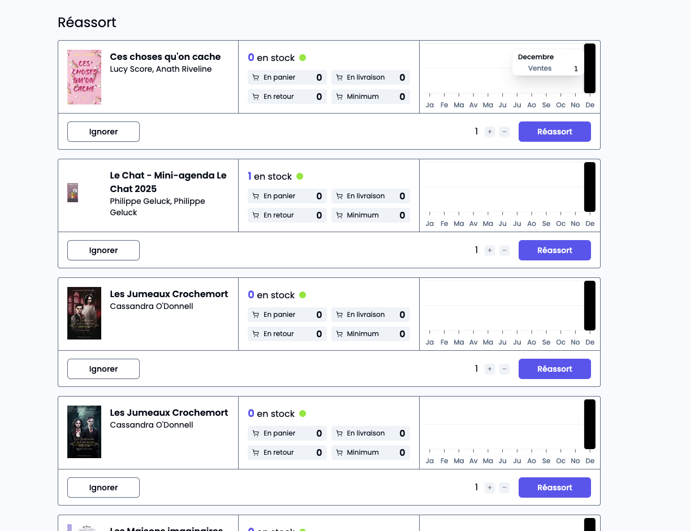
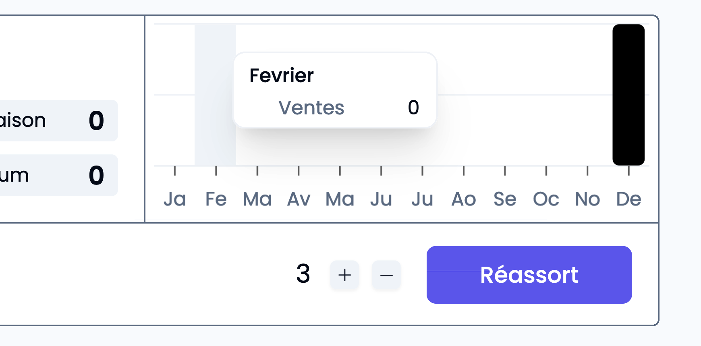

*Savoir quoi et quand passer commande à ses fournisseurs constitue le nerf de la guerre du métier de libraire. Voyons comment Alexandrie vous aide dans cette tâche*

---

### Visualiser rapidement toutes les titres destockés récemment dans les notifications de réassort.

Dès qu’un titre est déstocké, **le plus souvent suite à une vente**, une notification de réassort est créé. 

### Faut-il réassortir ? 

Dans la notification de réassort, le libraire dispose de toutes les informations dont il a besoin pour prendre sa décision de réassort: 

- L’état des stock (le stock actuel et le stock en cours d’acheminement).
- L’état des ventes sur les 12 derniers mois.

Une fois réassorti, le titre vient automatiquement s’ajouter au panier de commande courant pour le fournisseur. Si la notification est ignorée, il ne se passe rien. Quel que soit le choix, une fois la notification traitée, elle disparaît.

Vous vous posez d’autres questions sur la prise en main d’Alexandrie ? Ces guides pourraient vous êtres utiles.

- [Comment chercher un livre dans Alexandrie ?](https://blog.alexandrie.app/p/comment-chercher-un-livre-dans-alexandrie)
