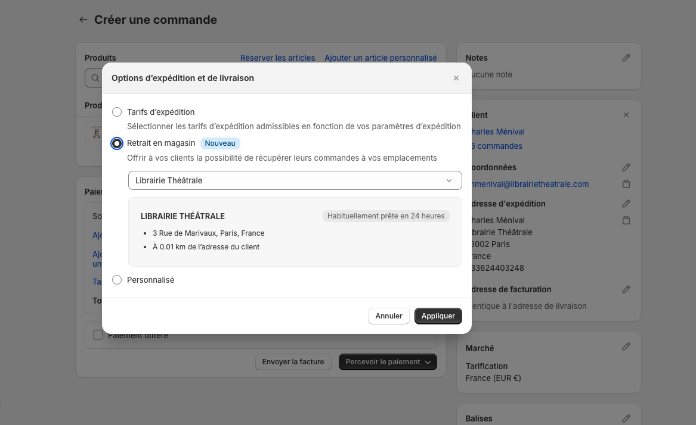
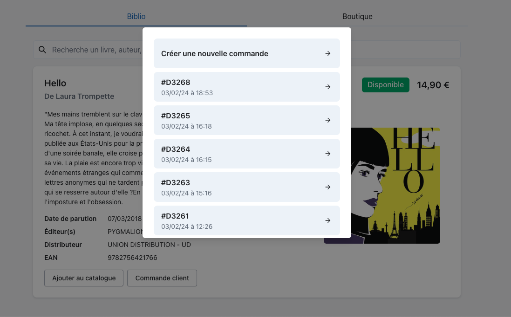
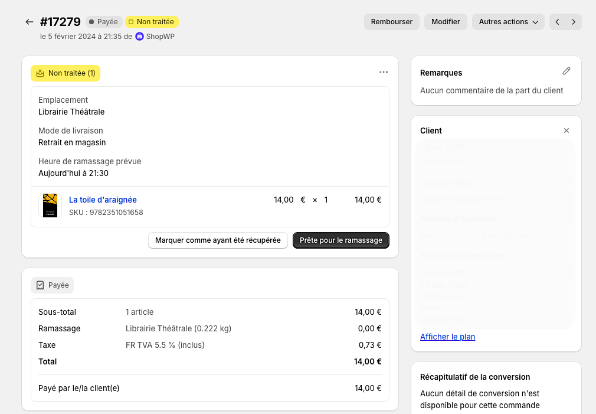
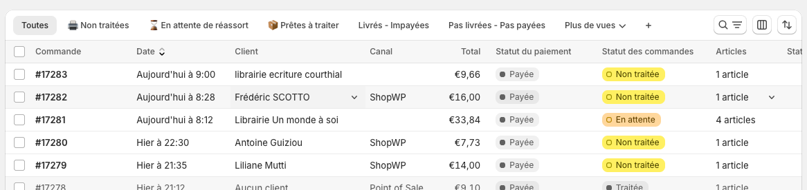

*Un client entre en boutique, se dirige vers vous et vous demande un livre dont vous n’avez jamais entendu parler. Vous utilisez votre recherche, trouvez le livre en question, qui s’avère disponible chez le fournisseur. Il souhaite le commander. Cette situation est un classique du métier de libraire. Voyons comment la gérer avec Alexandrie.*

---

**Note 1**: Si la notion de catalogue est obscure pour vous, faites un tour sur [cet article](https://blog.alexandrie.app/p/comment-alexandrie-vous-aide-a-constituer-votre-catalogue).

## Étape 1: Créer la commande

### Cas n°1 : le titre est déjà dans votre catalogue (mais pas en stock)

Créez simplement une commande classique dans Shopify.

1. Entrez les coordonnées de votre client.
2. Choisissez le mode de livraison “Retrait en magasin”.  Vous pouvez également proposer la livraison si votre client préfère être livré.
3. Si votre client paye d’avance, vous pouvez marquer la commande comme payée, sinon marquez-là en paiement différé.
4. Validez la commande.

> 💡 Attention, le mode de livraison “Retrait en magasin” n’est disponible que si le client à une adresse d’expédition enregistrée. Si c’est sa première commande, vous pouvez lui demander son code postal ou entrer le nom de votre ville.

### Cas n°2 : le titre n’est pas dans votre catalogue

Il faut d’abord ajouter le titre à votre catalogue, puis le placer dans une commande. Alexandrie gère tout cela pour vous.

1. Faites [une recherche bibliographique](https://blog.alexandrie.app/p/comment-chercher-un-livre-dans-alexandrie) pour vérifier que le titre est disponible à la commande.
2. Lorsque vous avez trouvé le titre, cliquez sur `Commande client` . Un menu s’ouvre vous proposant soit de créer une nouvelle commande, soit d’ajouter le titre à une commande existante.
3. Rendez-vous sur la commande et effectuez la suite des opérations comme si vous étiez dans le cas n°1.

## Étape 2: traiter la commande.

Mes commandes clients sont créées mais que se passe-t-il ? Comment cela impacte-t-il mes commandes fournisseur et mes réceptions ?

### Commande du stock manquant auprès de vos fournisseurs

Lorsque le stock de votre boutique ne suffit pas à couvrir le nombre d’exemplaires commandés, Alexandrie ajoute automatiquement les articles au panier du fournisseur correspondant.

> 💡 *Si un client me commande 1 exemplaire de Hello, et que je n’en ai aucun en stock, il ajoute 1 exemplaire au panier de commande du fournisseur de Hello.* 

> 💡 *Si un client me commande 5 exemplaires de Good Bye, et que j’en ai 2 en stock, il ajoute 3 exemplaires au panier de commande du fournisseur de Good Bye.*

### Quand la commande arrive…

Au moment de la réception, Alexandrie vous propose de visualiser les commandes clients contenues dans une réception afin que vous puissiez les mettre à part. Si tous les articles sont arrivés, il ne vous reste plus qu’à prévenir votre client via l’interface Shopify.

### Suivi des commandes, personnalisation, automatisation

Chaque librairie ayant sa propre organisation et un flux de commandes différent, libre à vous de trouver la meilleure façon d’organiser votre fonctionnement. Pour cela, Shopify propose de créer des vues personnalisées pour organiser vos commandes en fonction de vos besoins.

D’autre part, un des avantages majeurs de Shopify est la possibilité de programmer des actions automatiques avec un minimum de connaissance en code. Vous pouvez par exemple :

- Envoyer un mail automatique dès qu’une commande en attente dépasse X jours.
- Tagger automatiquement vos commandes en fonction de certains critères.
- Imprimer automatiquement une facture ou un ticket à chaque nouvelle commande ou lorsque la commande est traitée.

Vous avez des *workflow* en tête ? Vous voulez en discuter pour en estimer la faisabilité ? N’hésitez pas à nous contacter à [jordan@alexandrie.app](mailto:jordan@alexandrie.app). 
