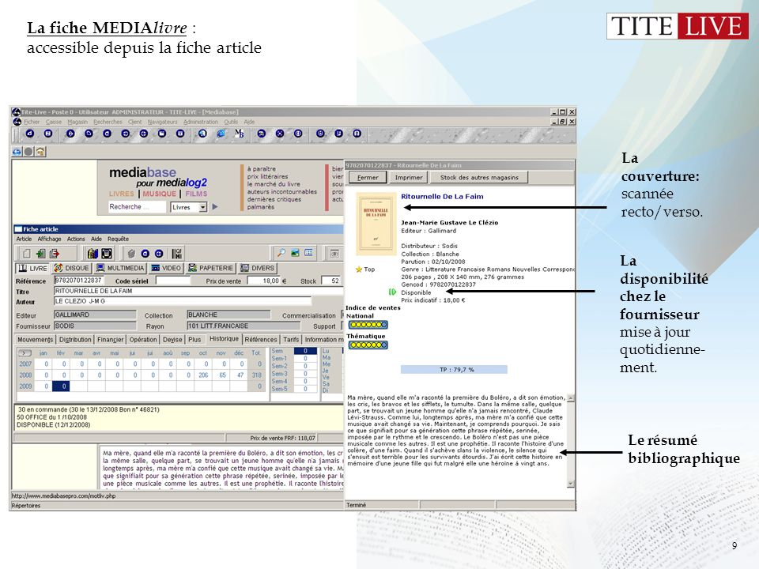
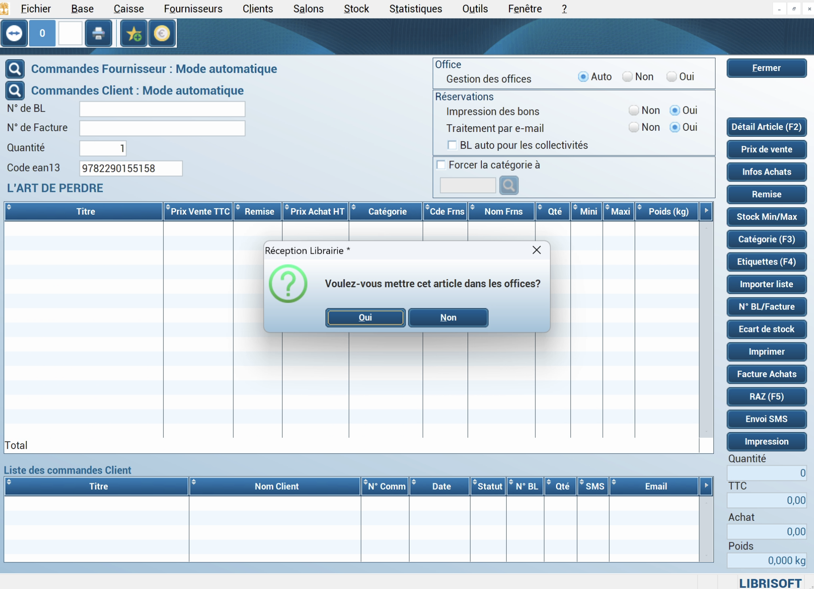

Au moment de créer, reprendre ou rééquiper une librairie, la question revient toujours : quel logiciel de gestion choisir ? L’offre spécialisée est restreinte, et chaque solution répond à un profil différent.

> **Transparence :** cet article est rédigé par l’équipe d’Alexandrie, l’une des solutions présentées. Les tarifs des autres éditeurs sont des ordres de grandeur, à confirmer auprès de chacun.

## Les critères qui comptent

- **Le coût d’entrée.** Licence, installation, formation, reprise des données : avec les logiciels traditionnels, le devis atteint souvent plusieurs milliers d’euros avant le premier mois d’abonnement.
- **L’abonnement.** Regardez ce qu’il inclut et si la tarification se fait au poste.
- **L’ergonomie et la mobilité.** Un logiciel installé sur un poste, ou une application accessible partout ?
- **La connexion à l’interprofession.** Dilicom, base bibliographique (FEL ou Electre), avis d’expédition.
- **La caisse certifiée NF525.** Elle est obligatoire pour encaisser auprès de particuliers.

## Tite-Live, le leader historique

[Tite-Live](https://www.titelive.com) est l’une des solutions les plus répandues en librairie, en France, en Belgique et aux Pays-Bas.

- **Points forts :** un logiciel tout-en-un, avec une base bibliographique intégrée. C’est une solution éprouvée pour les gros volumes.
- **À prendre en compte :** une ergonomie jugée datée par une partie des utilisateurs, une ouverture limitée vers les outils tiers et un tarif haut de gamme indexé sur le chiffre d’affaires.
- **Pour qui ?** Les librairies établies, avec le budget correspondant.

## Librisoft, l’efficacité sans fioritures

Développé par [2DCOM](https://www.2dcom.fr), Librisoft couvre l’essentiel du métier avec un fonctionnement simple. Il s’appuie sur le FEL pour la base bibliographique.

- **Points forts :** un outil efficace sur les commandes clients et les rapports de ventes, avec un abonnement accessible.
- **À prendre en compte :** un logiciel Windows tarifé au poste, une mobilité limitée, une vente en ligne liée à la solution de l’éditeur et une formation payante.
- **Pour qui ?** Les librairies qui recherchent un outil classique sur poste.

## Bookshop, l’exhaustivité

Conçu par CDI pour la librairie Mollat, Bookshop s’est ensuite ouvert à d’autres établissements.

- **Points forts :** une application web, intégrée à Electre, avec une couverture fonctionnelle très large.
- **À prendre en compte :** une vente en ligne liée à une solution spécifique et l’un des budgets les plus élevés du marché.
- **Pour qui ?** Les grandes librairies en quête d’exhaustivité.

## Alexandrie, la librairie qui s’ouvre partout

Lancé en 2023, [Alexandrie](https://alexandrie.app) est un logiciel de gestion de librairie conçu dès le départ pour le web.

**Accessible partout, nativement.** Il suffit d’un navigateur, sur ordinateur, tablette ou téléphone. Pas de poste maître, pas de bureau à distance, aucun bricolage pour travailler depuis la réserve, chez soi ou sur un salon.

**Une ergonomie pensée avec les libraires.** L’interface a été retravaillée avec plus de 30 librairies, pour coller aux gestes du quotidien : commander, réceptionner, retrouver une commande client.

**Une caisse nomade.** La caisse certifiée NF525 tourne sur un téléphone ou une tablette, sans PC. Elle s’emporte partout et fonctionne hors ligne : salon, dédicace, marché, vente hors les murs.

**La puissance de Shopify pour vendre.** Vous vendez en boutique, sur votre site, sur les réseaux sociaux, et auprès des collectivités grâce à un site B2B dédié, avec un seul stock pour tout. Si vous hésitez encore à vendre en ligne, [cet article pèse les avantages et les obstacles](/p/librairie-et-vente-en-ligne).

**La précision d’Alexandrie pour acheter.** Alexandrie gère le cœur de votre métier :

- connexion à l’interprofession (Dilicom, FEL) ;
- suivi des commandes ;
- réceptions à partir des avis d’expédition ;
- statistiques.

**Un tarif simple.** [100 € HT par mois pour une entreprise, 50 € HT par mois pour une association](https://alexandrie.app/#pricing), plus l’abonnement Shopify. C’est le tarif le plus compétitif du marché. Il n’y a ni licence, ni installation, ni formation facturée.

**Un accompagnement gratuit.** La mise en route et la migration de vos données sont offertes.

**Pour qui ?** Les librairies qui veulent un outil moderne, utilisable partout, sans immobiliser leur trésorerie dans une installation.

## Tableau comparatif

:::table{highlight="Alexandrie"}
|  | Alexandrie | Tite-Live | Librisoft | Bookshop |
| --- | --- | --- | --- | --- |
| Accès | Navigateur, tous appareils | Windows, au poste | Windows, au poste | Navigateur |
| Caisse | Nomade sur téléphone ou tablette, hors ligne | Reliée au poste (fixe ou portable), hors ligne | Reliée au poste (fixe ou portable), hors ligne | N/A |
| Base bibliographique | FEL (Dilicom) | Intégrée | FEL (Dilicom) | Electre |
| Coût d’entrée | 0 €, migration offerte | Sur devis | Sur devis | Sur devis |
| Abonnement | 100 € HT (50 € HT pour les associations) + Shopify | Élevé | Modéré | Élevé |
:::

## Questions fréquentes

### Combien coûte un logiciel de gestion de librairie ?

Additionnez le coût d’entrée, qui peut atteindre plusieurs milliers d’euros, et l’abonnement, qui va d’environ 100 € à plus de 400 € par mois selon la solution.

### Peut-on changer de logiciel en cours d’activité ?

Oui, de préférence hors période de forte activité. Vérifiez qui prend en charge la reprise de vos données. Chez Alexandrie, elle est offerte. Les points de vigilance d’une migration sont détaillés dans [Est-ce facile de changer de logiciel de librairie ?](/p/changer-logiciel-de-gestion-de-librairie)

### Faut-il un ordinateur pour encaisser ?

Pas nécessairement. Une caisse certifiée NF525 peut fonctionner sur tablette ou téléphone, y compris hors ligne.
