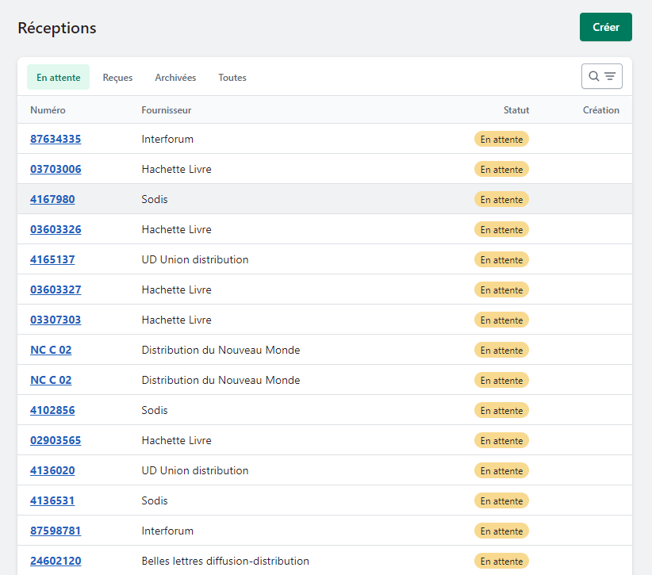
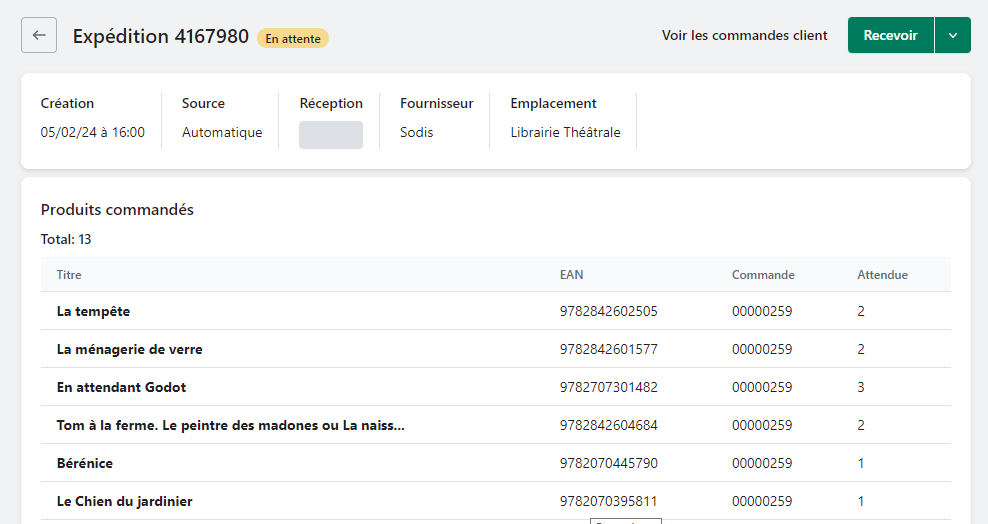
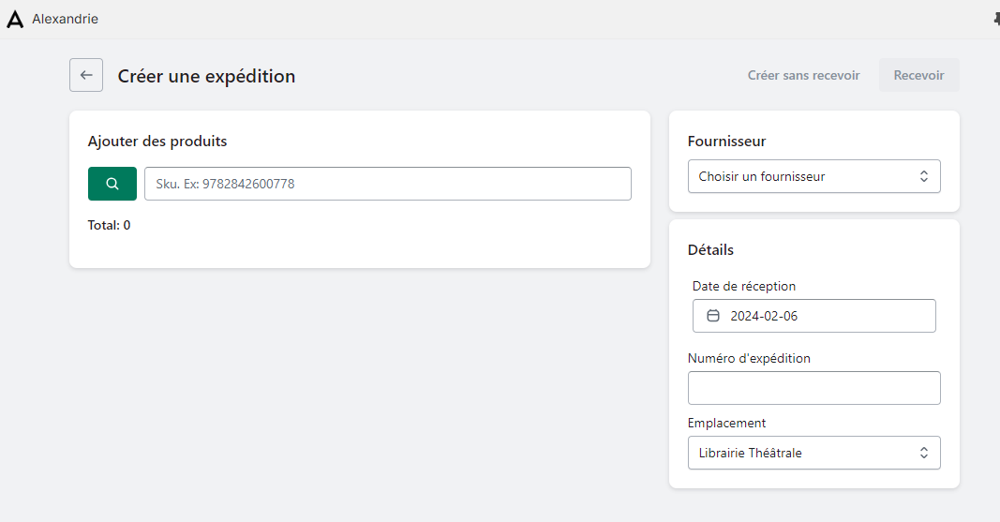

*Réceptionner des cartons de livres, c’est un peu comme ouvrir ses cadeaux de Noël. Mais cela peut devenir un défi majeur dès que le volume de carton augmente. Découvrons ensemble comment le logiciel Alexandrie simplifie et accélère le processus de réception de vos commandes fournisseurs.*

---

Pour commencez à réceptionner un colis, rendez-vous dans l’onglet Réceptions d’Alexandrie. Vous y verrez s’afficher une liste à plusieurs onglets: 

- **En attente** : la réception a été actée par le fournisseur via un avis d’expédition, mais n’est pas encore arrivée jusqu’à vous.
- **Reçue** : la réception a déjà été intégralement reçue.

### Cas n°1 : votre fournisseur émet des avis d’expédition.

Si votre fournisseur émet des avis d’expédition, ceux-ci apparaissent dans la liste des réceptions en attente. Cherchez votre colis en scannant son code-barre ou en saisissant son numéro.

Cliquez sur l’avis d’expédition correspondant. Une liste s’affichent avec le contenu du colis. Vérifiez-le et, si tout est valide, cliquez sur Recevoir. Votre colis est réceptionné !

### Cas n°2 : votre fournisseur n’émet pas d’avis d’expédition

Si votre colis n’a pas d’avis d’expédition, vous devrez le réceptionner *manuellement*. 

1. Dans la page des réceptions, cliquez sur `Créer`  ( une page s’affiche vous permettant de réceptionner des articles).
2. Choisissez le fournisseur correspondant dans le menu et bippez vos articles. Si un article n’a pas de code-barres vous pouvez le rechercher dans le catalogue en cliquant sur l’icône loupe.
3. Quand vous avez fini de scanner tous vos articles, cliquez sur Recevoir en haut à droite. Votre carton est réceptionné !

