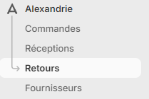
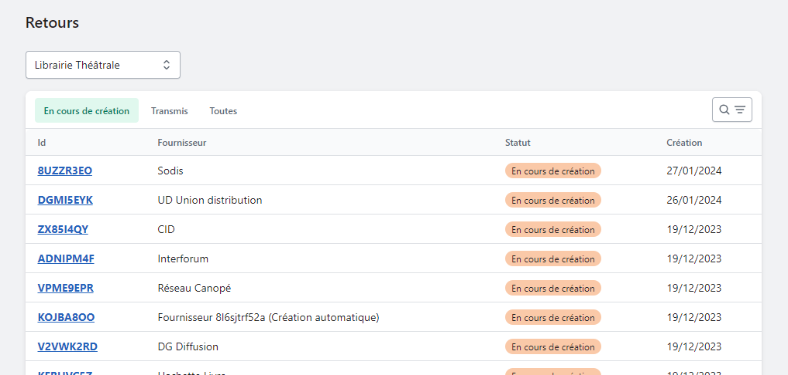
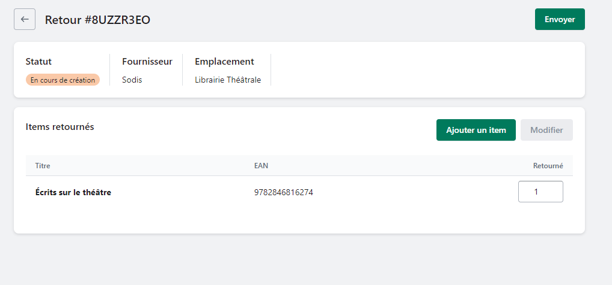

*Égaré sur son présentoir, cela fait 6 mois que ce livre n’a pas trouvé preneur. Il est peut-être venu le temps de le renvoyer au fournisseur. Découvrez comment retourner vos invendus avec Alexandrie.*

---

Pour retourner des ouvrages, cliquez sur l’onglet Retours dans le menu Alexandrie .

Une liste des paniers de retours en cours s’affichent pour chacun de vos fournisseurs. Cliquez sur le fournisseur chez qui vous souhaitez effectuer un retour.

Un écran s’affiche vous permettant d’ajouter des articles à retourner. Quand vous avez finalisé votre retour cliquez sur envoyer. Cela aura pour effet de: 

- Déstocker la quantité retournée.
- Générer un bon de retour que vous pourrez téléchargez et glisser dans le colis.

