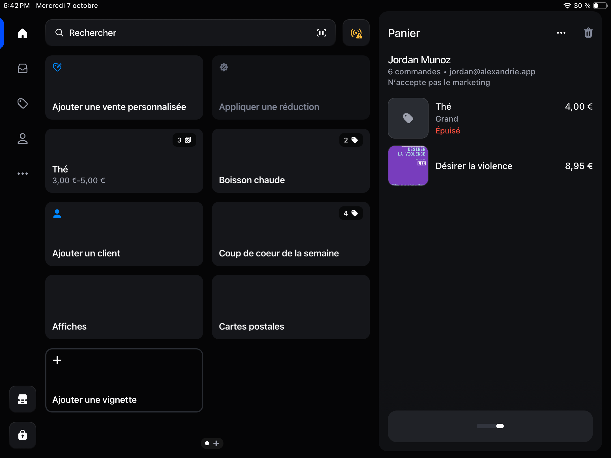
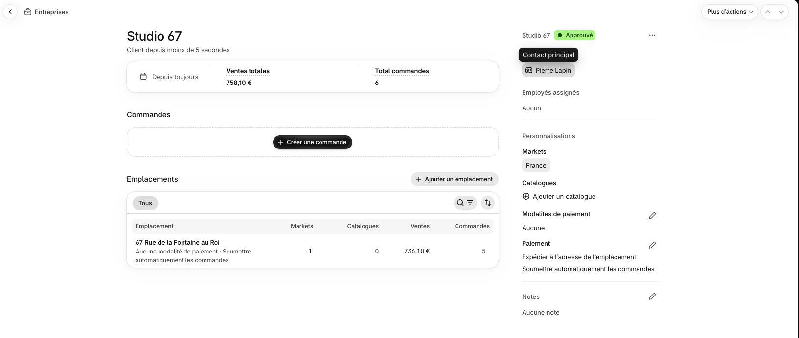
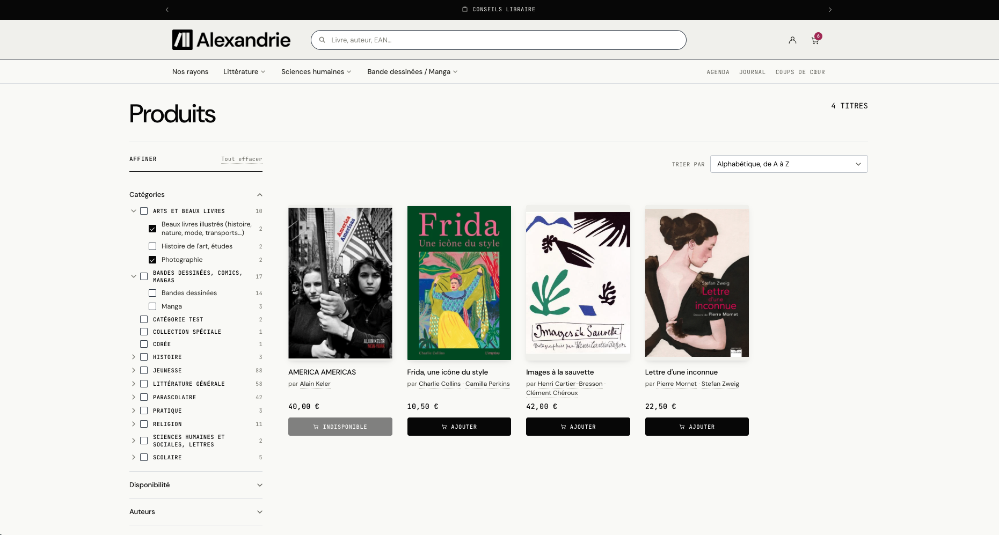
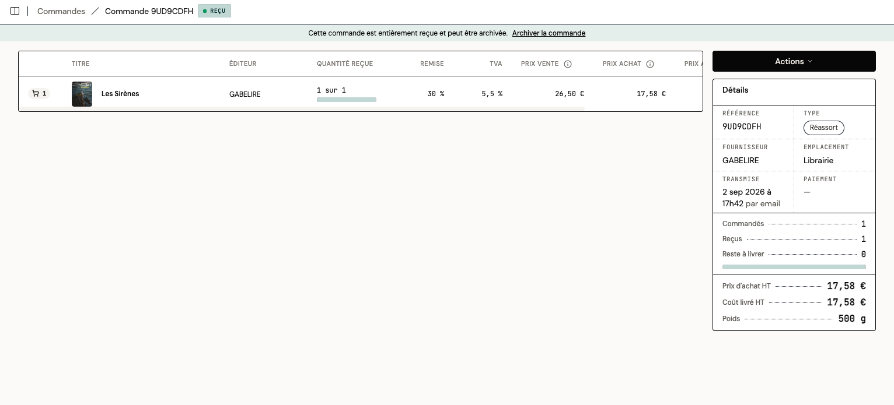
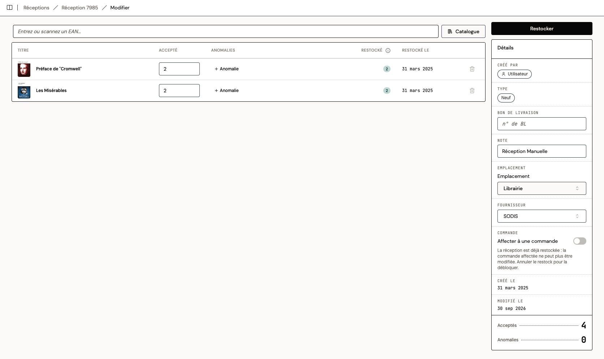
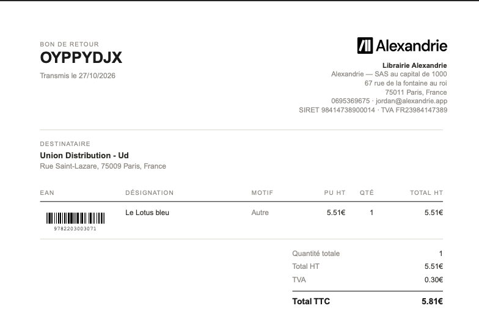

De plus en plus de libraires indépendants gèrent leur librairie avec Shopify : la caisse, le site, le stock, les clients, les paiements et les rapports, réunis dans un outil qui tient dans une tablette. Sur la vente, en boutique comme en ligne, c'est la plateforme la plus aboutie du marché. Ce qui est propre au métier de libraire, la base de données du livre (FEL), le réseau fournisseur (Dilicom), les réceptions, les retours, s'y ajoute avec une application.

Cet article décrit ce que Shopify apporte à une librairie, ce qui reste propre au métier de libraire, comment Alexandrie et Shopify fonctionnent ensemble, et pour quelles librairies le duo est le plus adapté.

## Pourquoi des libraires passent sur Shopify

Quatre arguments reviennent dans les librairies qui ont fait ce choix.

**Un moteur de gestion solide : un seul catalogue, un seul stock.** La boutique et le site partagent le même catalogue, le même stock et les mêmes clients. Une vente en caisse retire l'exemplaire du site, une commande en ligne le retire de la boutique, et le retrait en librairie est natif. Chaque soir, les rapports disent ce qui s'est vendu, par rayon et par canal, et ce qu'il reste.

**Une prise en main facile, et tout vous suit.** Rien à installer : Shopify s'utilise dans un navigateur, et la caisse est une application sur iPad, iPhone ou Android, avec le TPE de votre banque. Vous préparez vos commandes de chez vous, vous regardez les ventes du jour sur votre téléphone, vous emportez la caisse sur un salon ou dans un événement, et elle continue de tourner hors connexion. Ni poste maître, ni serveur, ni sauvegarde à gérer.

**Polyvalent, donc fait pour les librairies hybrides.** Tout se vend dans le même outil, chaque produit avec sa TVA : livres à 5,5 %, papeterie et jeux à 20 %, café à 10 %, cartes cadeaux, ateliers, abonnements. On choisit ce qui s'affiche en ligne et ce qui reste en boutique, on place ses raccourcis sur la caisse. Librairie-papeterie, librairie-café, librairie-galerie : un seul outil, une seule caisse.

**Un site qui ressemble à la librairie, et qui vend.** Les sites Shopify sont beaux, modifiables sans développeur, à l'image de la boutique. Ils sont rapides, bien référencés sur Google et conçus pour convertir : fiches livres avec couverture et résumé, collections par rayon, recherche, Shop Pay, relance des paniers abandonnés, retrait en librairie ou expédition. Il existe des thèmes conçus pour les librairies.

**Les collectivités et les professionnels ont leur compte, leurs tarifs et leurs factures.** Bibliothèques, écoles, comités d'entreprise, entreprises : chaque organisation a son compte, avec les personnes autorisées à commander en son nom. Elles accèdent à un espace professionnel du site, avec leurs tarifs et leurs conditions de paiement. Chaque commande professionnelle donne une facture, émise depuis Shopify, que vous envoyez ou que le client télécharge lui-même.

**Et un coût bas, connu d'avance.** 27 € par mois en paiement annuel, soit 324 € par an, caisse et boutique en ligne incluses. Pas de licence, pas de frais d'installation, pas de contrat de maintenance. Le détail est plus bas.

La caisse complète tient en quatre éléments : une tablette ou un téléphone, une douchette, une imprimante de tickets avec tiroir-caisse, et le TPE de votre banque. De l'ordre de 400 € hors tablette, une fois.

## Ce qui reste propre au métier de libraire

Shopify est conçu pour tous les commerces. Le livre a ses circuits et ses règles, que Shopify n'a pas à connaître.

Un libraire ne saisit pas ses livres : il les prend dans la base de données du livre, le FEL de Dilicom, avec leur prix, leur TVA et leur disponibilité. Il commande aux distributeurs par le réseau fournisseur, Dilicom encore, aux conditions de chacun. Il pointe ses colis à partir des avis d'expédition, renvoie ce qui n'a pas marché dans les délais de retour, décide après chaque vente quoi recommander et chez qui, tient les dépôts des éditeurs locaux et des auteurs auto-édités, et fait remonter son stock sur Place des libraires, le Pass Culture et librairiesindependantes.com.

Shopify n'a ni connecteur FEL, ni module d'achat, ni réception, ni retour fournisseur. C'est le travail d'un logiciel de librairie. Alexandrie a été conçu pour l'apporter à Shopify.

## Alexandrie : le logiciel de librairie qui tourne dans Shopify

[Alexandrie](https://alexandrie.app) s'installe en quelques minutes et s'ouvre dans votre navigateur. Shopify encaisse et vend, Alexandrie fait le travail de libraire, et rien n'est saisi deux fois. Voici ce qu'elle prend en charge, dans l'ordre d'une journée en librairie.

**Le catalogue.** Alexandrie est reliée à la base de données du livre (FEL) : un ISBN suffit pour créer la fiche dans Shopify avec le titre, la couverture, le résumé, le prix éditeur et la TVA à 5,5 %. Vous rangez ensuite vos livres par rayon, vous retravaillez les fiches qui le méritent, vous signalez vos coups de cœur, vous ajoutez votre avis de libraire et vos propres métadonnées. Le site affiche tout cela.

**Les achats.** Après chaque vente, Alexandrie vous dit quoi recommander et chez qui. Vous validez, la commande part vers le distributeur par le réseau fournisseur (Dilicom), et vous suivez son état jusqu'à la livraison.

**Les réceptions.** Vous pointez un colis à partir de l'avis d'expédition du distributeur. Le carton entier entre en stock d'un coup dans Shopify, les commandes correspondantes passent en « reçues », et ce qui manque ou arrive abîmé est consigné pour le litige avec le transporteur.

**Les retours.** Alexandrie repère ce qui a vieilli en rayon, prépare le retour aux conditions du fournisseur et le transmet. C'est aussi là que vous déstockez.

**Les dépôts-ventes.** Éditeurs locaux, auteurs auto-édités : chaque dépôt est suivi, et vous sortez un relevé par déposant.

**Les commandes clients.** Un livre commandé pour un client est suivi de la commande au fournisseur jusqu'au retrait en librairie.

**Les rapports.** Achats, retours, composition du stock, ventes par rayon, par éditeur, par jour ou par mois. Les chiffres qu'un libraire regarde, pas ceux d'un commerce générique.

**L'interprofession.** Votre stock remonte sur Place des libraires et le Pass Culture.

Les règles du livre sont respectées d'office. Le prix éditeur et la TVA à 5,5 % viennent de la base de données du livre ; la remise reste plafonnée à 5 %, en boutique ou en retrait ; les frais de port respectent le minimum de 3 € sous 35 € de livres ; un livre à commander ne s'affiche jamais comme disponible.

Shopify reste la caisse et le site. Shopify POS répond à la loi anti-fraude à la TVA : Shopify fournit une attestation de conformité et dispose d'un certificat NF525 délivré par INFOCERT. Alexandrie tient le catalogue, les achats et le stock.

### Ce que ça coûte, au total

Shopify et Alexandrie reviennent ensemble à environ 130 € par mois, hors matériel et frais de paiement.

| Poste | Montant | Remarque |
| --- | --- | --- |
| Abonnement Shopify Basic | 27 € par mois en paiement annuel, soit 324 € par an (36 € en mensuel) | Caisse incluse. Tarifs affichés par Shopify France à l'automne 2026. |
| Paiement en boutique | 0 € | Avec le TPE de votre banque, Shopify ne prélève rien. |
| Paiement en ligne | 1,5 % + 0,25 € par transaction | Avec Shopify Payments. |
| Matériel de caisse | Environ 400 € hors tablette, une fois | Douchette, imprimante de tickets, tiroir-caisse. Un iPad ou un téléphone que vous avez déjà fait l'affaire. |
| Thème | Gratuit ou payant | Alexandrie propose un thème conçu pour les librairies. |
| Nom de domaine | Environ 15 € par an |  |
| Logiciel de librairie (Alexandrie) | 100 € HT par mois, 50 € HT pour une association | Migration des données et prise en main incluses, sans frais d'installation. |

À comparer avec une licence, un poste de caisse dédié et un contrat de maintenance : le détail est dans [Quel logiciel de gestion de librairie choisir ?](https://blog.alexandrie.app/p/quel-logiciel-de-gestion-de-librairie-choisir).

## Les librairies pour lesquelles Shopify + Alexandrie est particulièrement adapté

N'importe quelle librairie, généraliste ou spécialisée, peut tourner sur Shopify et Alexandrie. Le duo se justifie encore plus dans ces situations.

- **Vous vendez hors les murs.** Salons, fêtes du livre, écoles, événements : la caisse part avec vous sur un téléphone, avec le TPE de votre banque, et le stock reste juste.
- **Vous vendez en ligne, ou voulez vous y mettre.** Le site partage le stock de la boutique, les fiches livres arrivent complètes, avec couverture et résumé, et le retrait en librairie est natif.
- **Vous faites du dépôt-vente.** Éditeurs locaux, auteurs auto-édités : Alexandrie suit les dépôts et produit les relevés par déposant.
- **Vous vendez de l'occasion.** Chaque exemplaire a son prix, en boutique comme en ligne, dans le même outil que le neuf.
- **Vous êtes une librairie-café, une librairie-papeterie ou une librairie multi-activité.** Tous les produits, chacun avec sa TVA, dans une seule caisse ; le livre garde ses règles.
- **Vous vendez aux collectivités et aux professionnels.** Shopify tient les comptes des bibliothèques, des écoles et des comités d'entreprise, avec leurs tarifs et leurs factures ; Alexandrie suit les commandes jusqu'à la livraison.

## Questions fréquentes

**Shopify est-il adapté à une librairie indépendante ?** Oui. Pour la vente, en boutique comme en ligne, c'est la plateforme la plus aboutie du marché. Pour le métier de libraire, base de données du livre (FEL), réseau fournisseur (Dilicom), réceptions, retours, on lui connecte un logiciel de librairie.

**Alexandrie fonctionne-t-il avec une boutique Shopify existante ?** Oui. Alexandrie s'installe depuis l'App Store Shopify sur votre boutique actuelle. Votre site, votre caisse et vos ventes ne changent pas ; le catalogue est complété à partir de la base de données du livre.

**Peut-on respecter le prix unique du livre sur Shopify ?** Oui. Les prix sont saisis TTC au prix éditeur, les réductions automatiques sont désactivées sur les livres et les codes de réduction plafonnés à 5 %, valables en boutique ou en retrait, jamais sur un livre expédié.

**Comment appliquer la TVA à 5,5 % sur Shopify ?** Les prix se saisissent TTC et chaque collection porte son taux : 5,5 % sur les livres, 20 % sur la papeterie et les jeux. Un réglage, fait une fois.

**Shopify POS est-il conforme NF525 ?** Shopify fournit une attestation de conformité à la loi anti-fraude à la TVA et dispose d'un certificat NF525 délivré par INFOCERT. Téléchargez l'attestation et conservez-la.

**Comment relier Shopify au réseau fournisseur (Dilicom) ?** Shopify n'a pas de connexion native au réseau fournisseur. Il faut une application de librairie qui synchronise la base de données du livre (FEL) et passe les commandes par Dilicom. C'est ce que fait Alexandrie.

**Quel forfait Shopify choisir pour une librairie ?** Basic, à 27 € par mois en paiement annuel, caisse incluse. C'est suffisant pour une librairie à un point de vente.

**Peut-on garder son TPE bancaire avec Shopify POS ?** Oui. Créez un mode de paiement personnalisé « Carte » : la vente est enregistrée dans Shopify, le paiement passe par votre banque, sans frais Shopify.

**Peut-on facturer les collectivités et les professionnels avec Shopify ?** Oui. Chaque organisation a son compte, ses acheteurs, ses tarifs et ses conditions de paiement, et accède à un espace professionnel du site. Les commandes passées par ce compte donnent des factures émises depuis Shopify.

**Combien coûte une librairie sur Shopify ?** 324 € par an pour le site et la caisse. Avec le logiciel de librairie, environ 130 € par mois, hors matériel et frais de paiement.
