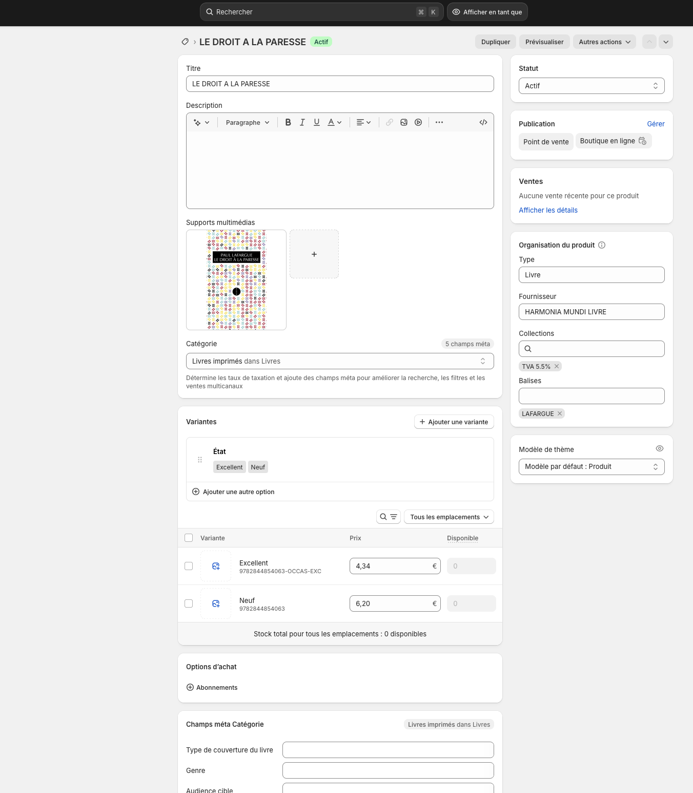

*Que ce soit par vocation écologique, pour attirer des publics au moyens plus modestes ou pour proposer des références rares qui sont épuisées chez les fournisseurs, , la vente de livres d’occasion a le vent en poupe ! Alexandrie vous aide à vous lancer facilement dans cette activité, qui peut être très chronophage.* 

### Un produit, plusieurs variantes…

Chaque livre est représenté par un produit unique. Chaque état de ce livre va se matérialiser sous forme de variante. 

> ⚠️ Pour le livre et produit “La Grande Transformation”, on peut avoir plusieurs états: neuf, excellent, très bon état, chacun représenté par une variante.

Dans Alexandrie, un produit peut être simple (sans variantes) ou complexe (avec des variantes). Si le produit a plusieurs variantes cela va se répercuter: 

- au passage en caisse, après avoir scanné un produit il faudra préciser la variante désirée.
- sur le site internet, sur la page produit, l’internaute peut choisir de mettre en panier la variante qui lui convient.

### Paramétrer la réception de livres d’occasion. 

Depuis la page **Paramètres > Livres d’occasion**, vous allez pouvoir prédéfinir des états pour vos futures variantes d’occasion. 

Vous pouvez ajouter: 

- Un nom pour l’état: 
  - *ex: Très bon état*
- Un suffixe qui viendra s’ajouter à la fin du SKU pour garder un identifiant unique: 
  - *ex: TBE donnera 9782070124749_OCCAS_TBE*
- Une réduction par défaut pour cet état par rapport au prix public. 
  - *ex: Tous les produits d’occasion en “Très bon état” auront un rabais de 40% par rapport à leur prix publi*c.

### Créer des variantes d’occasion pour un produit et les restocker

Depuis la page **Réception > Créer une réception d’occasion**, vous allez pouvoir: 

- Créer un produit dans votre catalogue
- Créer une variante d’occasion pour ce produit
- Restocker cette variante.
- Le tout d’un seul et même mouvement !

::video{src="./guide-occasion.mp4" caption="Créer un produit, une variante d’occasion et la restocker."}
